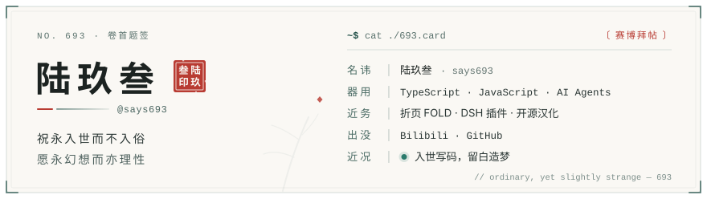
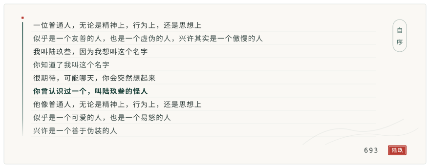

  <picture>
    <source media="(prefers-color-scheme: dark)" srcset="./assets/banner-dark.png" />
    <source media="(prefers-color-scheme: light)" srcset="./assets/banner-light.png" />
    
  </picture>

 

  <picture>
    <source media="(prefers-color-scheme: dark)" srcset="./assets/calling-card-dark.svg" />
    <source media="(prefers-color-scheme: light)" srcset="./assets/calling-card-light.svg" />
    
  </picture>

 

  <picture>
    <source media="(prefers-color-scheme: dark)" srcset="./assets/manifesto-dark.svg" />
    <source media="(prefers-color-scheme: light)" srcset="./assets/manifesto-light.svg" />
    
  </picture>

 

  <picture>
    <source media="(prefers-color-scheme: dark)" srcset="./assets/sec-works-dark.svg" />
    <source media="(prefers-color-scheme: light)" srcset="./assets/sec-works-light.svg" />
    
  </picture>

| 器物 | 分类 | 一句话注脚 |
| :--- | :---: | :--- |
| [**折页 FOLD (`tack`)**](https://github.com/says693/tack) | `TypeScript` | 连接自己的 AI，依可信资料生成离线本地课程与复习路径 |
| [**灵动岛 (`dsh-composer-dynamic-island`)**](https://github.com/says693/dsh-composer-dynamic-island) | `JavaScript` | 为 DSH 网页端裁一方克制紧凑的 Composer 灵动岛组件 |
| [**散句 (`dsh-scatter`)**](https://github.com/says693/dsh-scatter) | `JavaScript` | DSH 输入区 Prompt 改写与多候选流式推演插件 |
| [**小窗视界 (`dsh-artplayer`)**](https://github.com/says693/dsh-artplayer) | `JavaScript` | 轻量 DSH 侧栏视频插件，支持双击展开与长按三倍速 |
| [**译事 (`tern-omp-zh`)**](https://github.com/says693/tern-omp-zh) | `JavaScript` | Tern / omp 简体中文汉化包与自动维护 CLI |
| [**`ccch1mneyyy/dsh-TUI`**](https://github.com/ccch1mneyyy/dsh-TUI) · [**`dsh-Go`**](https://github.com/ccch1mneyyy/dsh-Go) | `社区协力` | 深度参与的 DSH 终端交互插件与移动端远程工具 |

 

  <picture>
    <source media="(prefers-color-scheme: dark)" srcset="./assets/ink-brush-dark.svg" />
    <source media="(prefers-color-scheme: light)" srcset="./assets/ink-brush-light.svg" />
    
  </picture>

 

  <picture>
    <source media="(prefers-color-scheme: dark)" srcset="./assets/sec-links-dark.svg" />
    <source media="(prefers-color-scheme: light)" srcset="./assets/sec-links-light.svg" />
    
  </picture>

  <a href="https://space.bilibili.com/388556477">
    <picture>
      <source media="(prefers-color-scheme: dark)" srcset="./assets/badge-bili-dark.svg" />
      <source media="(prefers-color-scheme: light)" srcset="./assets/badge-bili-light.svg" />
      
    </picture>
  </a>
  &nbsp;&nbsp;
  <a href="https://github.com/says693?tab=repositories">
    <picture>
      <source media="(prefers-color-scheme: dark)" srcset="./assets/badge-github-dark.svg" />
      <source media="(prefers-color-scheme: light)" srcset="./assets/badge-github-light.svg" />
      
    </picture>
  </a>

