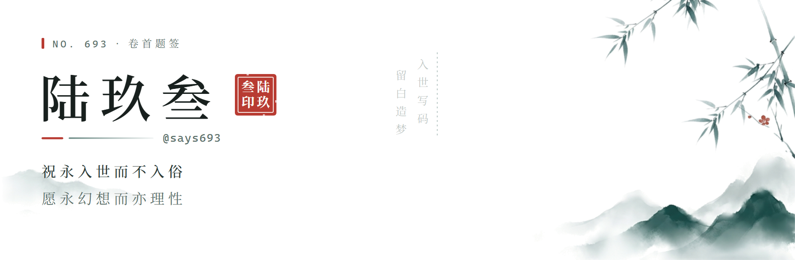
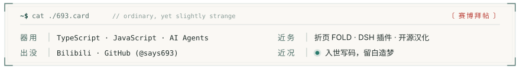
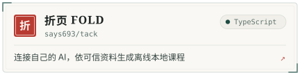
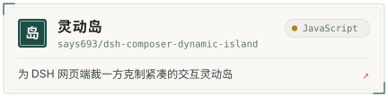
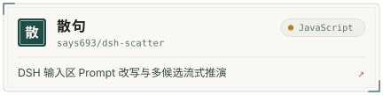
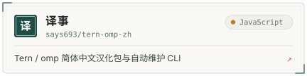
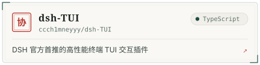
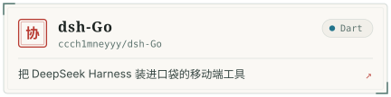

  <picture>
    <source media="(prefers-color-scheme: dark)" srcset="./assets/hero-dark.png" />
    <source media="(prefers-color-scheme: light)" srcset="./assets/hero-light.png" />
    
  </picture>

  <picture>
    <source media="(prefers-color-scheme: dark)" srcset="./assets/cyber-bar-dark.svg" />
    <source media="(prefers-color-scheme: light)" srcset="./assets/cyber-bar-light.svg" />
    
  </picture>

 

  <picture>
    <source media="(prefers-color-scheme: dark)" srcset="./assets/manifesto-dark.svg" />
    <source media="(prefers-color-scheme: light)" srcset="./assets/manifesto-light.svg" />
    
  </picture>

 

  <picture>
    <source media="(prefers-color-scheme: dark)" srcset="./assets/sec-works-dark.svg" />
    <source media="(prefers-color-scheme: light)" srcset="./assets/sec-works-light.svg" />
    
  </picture>

  <a href="https://github.com/says693/tack"><picture><source media="(prefers-color-scheme: dark)" srcset="./assets/work-tack-dark.svg" /><source media="(prefers-color-scheme: light)" srcset="./assets/work-tack-light.svg" /></picture></a>&nbsp;<a href="https://github.com/says693/dsh-composer-dynamic-island"><picture><source media="(prefers-color-scheme: dark)" srcset="./assets/work-island-dark.svg" /><source media="(prefers-color-scheme: light)" srcset="./assets/work-island-light.svg" /></picture></a>
   
  <a href="https://github.com/says693/dsh-scatter"><picture><source media="(prefers-color-scheme: dark)" srcset="./assets/work-scatter-dark.svg" /><source media="(prefers-color-scheme: light)" srcset="./assets/work-scatter-light.svg" /></picture></a>&nbsp;<a href="https://github.com/says693/tern-omp-zh"><picture><source media="(prefers-color-scheme: dark)" srcset="./assets/work-tern-dark.svg" /><source media="(prefers-color-scheme: light)" srcset="./assets/work-tern-light.svg" /></picture></a>
   
  <a href="https://github.com/ccch1mneyyy/dsh-TUI"><picture><source media="(prefers-color-scheme: dark)" srcset="./assets/work-tui-dark.svg" /><source media="(prefers-color-scheme: light)" srcset="./assets/work-tui-light.svg" /></picture></a>&nbsp;<a href="https://github.com/ccch1mneyyy/dsh-Go"><picture><source media="(prefers-color-scheme: dark)" srcset="./assets/work-go-dark.svg" /><source media="(prefers-color-scheme: light)" srcset="./assets/work-go-light.svg" /></picture></a>

 

  <picture>
    <source media="(prefers-color-scheme: dark)" srcset="./assets/ink-brush-dark.svg" />
    <source media="(prefers-color-scheme: light)" srcset="./assets/ink-brush-light.svg" />
    
  </picture>

 

  <picture>
    <source media="(prefers-color-scheme: dark)" srcset="./assets/sec-links-dark.svg" />
    <source media="(prefers-color-scheme: light)" srcset="./assets/sec-links-light.svg" />
    
  </picture>

  <a href="https://space.bilibili.com/388556477">
    <picture>
      <source media="(prefers-color-scheme: dark)" srcset="./assets/badge-bili-dark.svg" />
      <source media="(prefers-color-scheme: light)" srcset="./assets/badge-bili-light.svg" />
      
    </picture>
  </a>
  &nbsp;&nbsp;
  <a href="https://github.com/says693?tab=repositories">
    <picture>
      <source media="(prefers-color-scheme: dark)" srcset="./assets/badge-github-dark.svg" />
      <source media="(prefers-color-scheme: light)" srcset="./assets/badge-github-light.svg" />
      
    </picture>
  </a>

